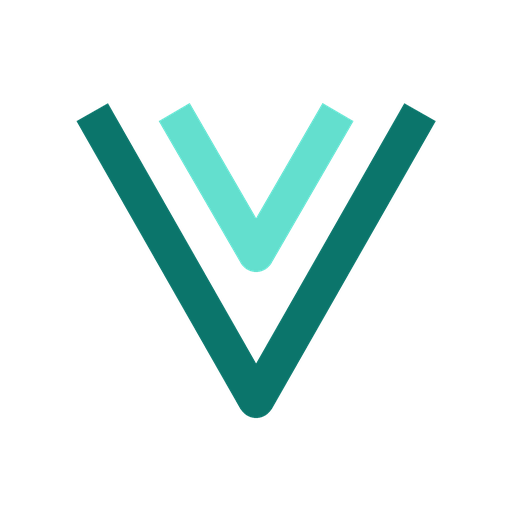
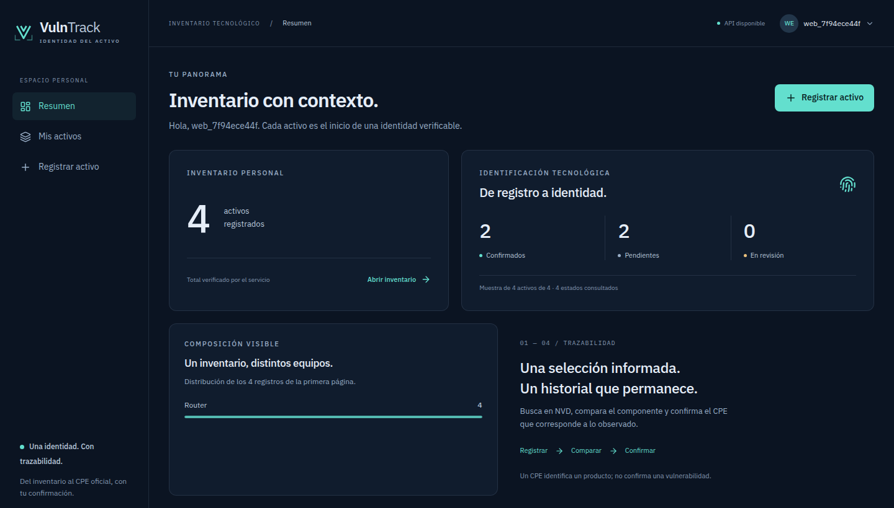

# VulnTrack Backend

API del sistema VulnTrack. Administra inventario y aplicaciones, identifica productos con CPE, consulta vulnerabilidades CVE de NVD cuando el servidor está configurado para ello y conserva resultados con su procedencia para revisión humana.

## About

Backend de VulnTrack: API que centraliza autenticación, autorización, inventario, identificación de productos mediante CPE y consultas CVE a NVD cuando el operador habilita el modo live. Conserva historial y procedencia para que los resultados potenciales sean revisados por una persona.

<p align="left"></p>

<p></p>

> La vista previa representa la interfaz web con datos sintéticos. Una consulta CVE por CPE no escanea la aplicación ni confirma que una vulnerabilidad sea explotable. La ejecución de ZAP y la verificación remota de objetivos no forman parte de la instalación de producción documentada.

## Estado y alcance

Este repositorio contiene una API FastAPI con compatibilidad V1 y servicios V2 de workspaces, aplicaciones y dispositivos. La configuración de producción de `deploy/production/` es un candidato cerrado: NVD live, worker CVE y registro se controlan en el servidor; no se deben habilitar por cambiar solo una variable pública del frontend. La guía de producción registra las verificaciones locales realizadas y mantiene el despliegue público en **NO-GO** hasta completar las comprobaciones del servidor.

La integración CVE real está disponible como capacidad del backend y puede habilitarse explícitamente en una instancia local autorizada. El modo predeterminado del launcher local es `fixture`; el candidato de producción inicia con CVE deshabilitado. Los fixtures se usan para pruebas y demostración y no son resultados actuales de NVD.

## Vista general

```text
Navegador React
    │ HTTPS / Bearer JWT
    ▼
FastAPI ───────────────► PostgreSQL de inventario, historial y CVE
    │                     (V1 y V2, roles SQL restringidos y RLS en V2)
    ├──────────────────► PostgreSQL separado del catálogo CPE
    │                     (lector de solo lectura)
    └─ petición CVE ───► services.nvd.nist.gov (solo modo live autorizado)
```

El cliente móvil o web llama a la API; nunca se conecta directamente a PostgreSQL. Los secretos de NVD y de firma permanecen en el backend. El catálogo CPE es una fuente distinta de la base privada de inventario y CVE.

## Tecnologías principales

- Python 3.12, FastAPI, Pydantic 2 y Uvicorn.
- SQLAlchemy 2, psycopg 3, PostgreSQL 16 y Alembic.
- PyJWT y Argon2id para tokens y hashes de contraseña.
- `httpx`, validación de contratos JSON y transporte HTTPS restringido para NVD.
- Docker Compose para los entornos locales y el candidato aislado de producción.

## Funciones y flujo de datos

1. **Cuenta y sesión:** el registro crea una cuenta y el workspace inicial cuando está habilitado. El inicio de sesión valida la contraseña con Argon2id y entrega un JWT Bearer de duración limitada. `GET /api/v1/auth/me` devuelve solo la identidad pública.
2. **Inventario V1:** los activos se guardan con propietario, campos validados, clave de idempotencia e historial compatible con versiones previas.
3. **Workspace y aplicación V2:** las aplicaciones y sus tecnologías pertenecen a un workspace. Los roles `owner`, `editor` y `viewer` se aplican en el servidor; leer un identificador ajeno no debe revelar su existencia.
4. **Identificación CPE:** el backend busca en el catálogo CPE configurado y registra la selección humana, el motivo, evidencia opcional, fuente y versión. La identificación debe corresponder a la versión observada; una coincidencia de catálogo solo identifica un producto.
5. **Consulta CVE:** solo una tecnología con identificación CPE confirmada y configuración live habilitada puede iniciar la consulta. El backend valida y persiste la ejecución, consulta la API CVE 2.0 oficial bajo límites, y guarda hallazgos y cobertura. Repetir una clave de idempotencia devuelve la operación original.
6. **Revisión:** los hallazgos se presentan como potenciales o indeterminados hasta que una persona evalúe aplicabilidad. Cero resultados no demuestra que el activo esté libre de vulnerabilidades.

### NVD y almacenamiento

- El catálogo de productos CPE se consulta por los servicios del catálogo y se mantiene en una base PostgreSQL separada. La importación/sincronización se opera con `scripts/sync_cpe_catalog.py` y `scripts/import_cpe_feed.py`; requiere una fuente elegida y configuración deliberada.
- Las consultas CVE live se envían desde el backend al host oficial fijo `services.nvd.nist.gov`, con verificación TLS, paginación acotada, límites de tiempo/tamaño, pausas y enfriamiento ante cuota. Una API key de NVD es opcional y nunca debe enviarse al frontend.
- La respuesta aceptada se persiste en PostgreSQL junto con CPE, fecha de origen, modo, cobertura, páginas y estado de caché. El estado `partial` significa que la cobertura es incompleta; `failed` no equivale a cero resultados.
- Los archivos de `tests/fixtures/` son muestras para pruebas. No son una base NVD descargada ni una fuente de producción. La base CPE/CVE local depende del volumen y del proceso de sincronización; no se incluye dentro de este repositorio.
- La consulta CVE no prueba una URL ni envía payloads al activo. ZAP, escaneo activo de red/dispositivos y la verificación remota real de propiedad no están habilitados en el despliegue descrito.

## Endpoints de referencia

La especificación exacta y los esquemas se publican en `/docs`, `/redoc` y `/openapi.json` al ejecutar la API. Las rutas principales incluyen:

| Método | Ruta | Uso |
|---|---|---|
| `GET` | `/health`, `/ready` | Estado del proceso y disponibilidad de dependencias/esquema. |
| `POST` | `/api/v1/auth/register` | Crear cuenta cuando el registro está habilitado y supera sus límites. |
| `POST` | `/api/v1/auth/login` | Obtener JWT Bearer. |
| `GET` | `/api/v1/auth/me` | Consultar identidad de la sesión. |
| `GET`, `POST` | `/api/v1/assets` | Listar activos propios o registrar uno con `Idempotency-Key`. |
| `GET` | `/api/v1/cpe-candidates` | Buscar candidatos CPE para el flujo V1. |
| `POST`, `GET` | `/api/v1/assets/{asset_id}/cpe-identifications` | Confirmar/listar identificaciones CPE V1. |
| `GET`, `POST` | `/api/v2/workspaces` | Listar o crear workspaces. |
| `GET`, `POST` | `/api/v2/workspaces/{workspace_id}/applications` | Listar o registrar aplicaciones. |
| `GET` | `/api/v2/cpe-catalog/status` | Consultar estado y fuente del catálogo CPE. |
| `GET` | `/api/v2/workspaces/{workspace_id}/applications/{application_id}/cpe-candidates` | Buscar CPE para una aplicación. |
| `PUT` | `.../technologies/{technology_id}/cpe` | Confirmar CPE, motivo y evidencia de la tecnología. |
| `POST` | `.../technologies/{technology_id}/analyses` | Solicitar análisis CVE; sujeto a permisos, CPE y configuración del servidor. |
| `GET` | `.../analyses`, `.../analyses/{run_id}/findings` | Consultar ejecuciones y hallazgos guardados. |
| `GET`, `POST`, `PATCH` | `/api/v2/workspaces/{workspace_id}/devices...` | Inventario, revisión y flujo CPE/CVE de dispositivos V2. |

En las rutas abreviadas `...` representa el prefijo de workspace y aplicación que se muestra completo en `/docs`. Las funciones de `targets`/`verifications` no implican que haya un escáner disponible; el endpoint de verificación remota responde como no disponible y ZAP no se inicia.

## Controles de seguridad implementados

- **Autenticación:** Argon2id, JWT firmado con secreto externo, expiración acotada, mensajes genéricos de login y límites de intentos. Registro con validación de usuario/contraseña y limitación de frecuencia.
- **Autorización:** filtros por dueño en V1; roles de workspace en V2; contexto HMAC de corta duración y RLS para operaciones V2. El cliente no puede escoger el propietario ni firmar el contexto.
- **SQL y validación:** SQLAlchemy y consultas parametrizadas, validación Pydantic, límites de paginación/cuerpo, rechazo de campos adicionales y validación de identificadores. El ORM ayuda a parametrizar valores, pero no reemplaza autorización, validación ni revisión de SQL manual.
- **Integración externa:** el objetivo NVD está fijado en el backend, con TLS verificado y límites de respuesta/tiempo/cuota. No se acepta una URL arbitraria del usuario para la consulta CVE.
- **PostgreSQL:** login de aplicación separado del owner, privilegios mínimos y RLS/contexto firmado en V2. El lector del catálogo usa otra conexión de solo lectura.
- **Despliegue candidato:** los Compose de producción separan redes, mantienen bases y API sin puertos públicos, ejecutan servicios como no root, limitan capacidades y filesystem, usan TLS SQL y publican el proxy en loopback por defecto. El proxy fuerza HTTPS, CSP, HSTS de un año, `nosniff`, protección contra framing y política de referencia restrictiva. Consulta `deploy/production/VALIDACION_LOCAL.md` para el alcance exacto de las comprobaciones.
- **Datos:** observaciones y evidencias deben describir fuentes técnicas sin contraseñas, tokens, llaves ni datos personales. Los logs no deben contener secretos ni respuestas completas con información sensible.

### Límites de seguridad conocidos

- El JWT no tiene refresh ni revocación individual del lado del servidor; cerrar sesión borra el token del navegador, pero no revoca una copia robada antes de que expire. La rotación del secreto invalida todos los tokens.
- Algunos limitadores son locales al proceso; no escalar réplicas sin un almacén de cuotas compartido. La configuración de producción validada usa un único worker.
- El modo local fixture no realiza llamadas reales. El cliente CVE live se activa por configuración explícita del backend y el frontend debe compilar con modo live; poner `VITE_NVD_MODE=live` por sí solo no habilita la API.
- El despliegue público no se considera listo hasta revisar el host, firewall, certificado, actualizaciones, monitorización, respaldos cifrados y recuperación en el servidor destino.
- El sistema no certifica cumplimiento, ausencia de vulnerabilidades ni seguridad de un activo. Los hallazgos NVD requieren validación humana.

## Ejecución local

Requisitos: Docker con Compose, Python 3.12, Node.js según el lockfile del frontend, y los cuatro repositorios hermanos dentro del directorio de trabajo.

En PowerShell, desde `vuln-track-backend`:

```powershell
py -3.12 -m venv .venv
.\.venv\Scripts\python.exe -m pip install -e ".[dev]"
.\.venv\Scripts\python.exe -m scripts.v2_development status --profile rc3-catalog31
.\.venv\Scripts\python.exe -m scripts.v2_development up --profile rc3-catalog31 --frontend ..\vuln-track-frontend --nvd-mode fixture
```

El launcher gestiona la configuración local privada bajo `.local/`; no versionar ni compartir esa carpeta. La interfaz y puertos dependen del perfil y se reportan por el launcher. Para detener o inspeccionar la instalación, consultar `python -m scripts.v2_development --help` y el manual local correspondiente. No borres volúmenes ni ejecutes `down -v` para reparar errores.

Para solicitar consultas live, primero inicia conscientemente una instancia local, verifica el modo del catálogo y la configuración del backend, y usa `--nvd-mode live`. Esto contacta la API de NVD y consume cuota; no es necesario para compilar o probar la interfaz. Consulta [la guía de uso CVE](docs/GUIA_USO_CONSULTA_CVE_NVD_REAL.md). La configuración de producción documentada continúa deshabilitada.

## Pruebas y validación

Las pruebas unitarias están bajo `tests/unit`; las de PostgreSQL y migraciones bajo `tests/integration`. Las suites de integración requieren bases desechables y no deben apuntarse a una instalación personal. Los resultados históricos y sus límites están en `docs/TEST_RESULTS*.md`, `docs/MVP_A_RESULTS.md`, `docs/MVP_B_RESULTS.md` y `deploy/production/VALIDACION_LOCAL.md`.

Comandos habituales (ejecutar únicamente con el entorno desechable configurado según sus guías):

```powershell
.\.venv\Scripts\python.exe -m pytest tests\unit
.\.venv\Scripts\python.exe -m ruff check app alembic scripts tests
$env:DATABASE_V1_PATH = "..\vuln-track-database"
.\.venv\Scripts\python.exe scripts\test_postgres.py -q
```

El último comando en PowerShell puede requerir establecer `$env:DATABASE_V1_PATH` primero. No ejecutes las pruebas de integración contra bases que contengan datos que quieras conservar.

## Estructura del repositorio

```text
app/api/              Endpoints V1/V2
app/core/             Configuración, autenticación, errores y seguridad
app/db/               Sesiones, migraciones y esquemas de persistencia
app/integrations/     Contratos y transporte hacia NVD
app/models/           Modelos SQLAlchemy
app/services/         Reglas de negocio, autorización, catálogo y análisis
alembic/              Migraciones de la base de aplicación
alembic_verification/ Migraciones del subsistema V2 de verificación
scripts/              Launcher, sincronización, mantenimiento y pruebas aisladas
deploy/production/    Compose/Caddy y manual de operación del candidato
tests/                Pruebas unitarias e integración con servicios desechables
```

## Documentación relacionada

- [Endpoints y contratos](docs/API_ENDPOINTS.md) · [autenticación](docs/AUTHENTICATION.md) · [CORS](docs/CORS.md).
- [Integración de base de datos](docs/DATABASE_INTEGRATION.md) · [migraciones](docs/MIGRATIONS.md) · [idempotencia](docs/IDEMPOTENCY.md).
- [Guía de consulta CVE real](docs/GUIA_USO_CONSULTA_CVE_NVD_REAL.md) · [integración NVD](docs/V2_NVD_INTEGRATION.md) · [caché](docs/V2_CVE_CACHE.md).
- [Diseño MVP-A](docs/MVP_A.md) · [diseño MVP-B](docs/MVP_B.md) · [decisiones abiertas](docs/OPEN_DECISIONS.md).
- [Seguridad de integración](docs/INTEGRATION_SECURITY_REVIEW.md) · [revisión JWT](docs/JWT_SECURITY_REVIEW.md) · [operación de producción](deploy/production/GUIA_DESPLIEGUE_VULNTRACK_PRODUCCION.md).

## Licencia

Este repositorio se distribuye bajo [MIT](LICENSE).
