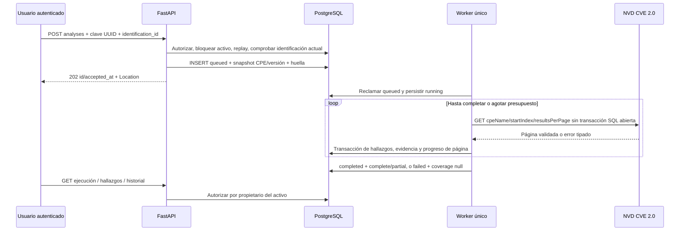

# MVP-B — consulta CVE persistente y conservadora

Implementación autorizada por la misión de Jesel del 2026-11-08, desde Backend
`2e12badb7a29d421c72c1faf1cf11de5383d0b1b` y Database
`80db7fd411f49f648263f275b412384bc49f7ed8`. Ratificación técnica conjunta de Rudi
PENDIENTE. D-001/D-002 conservados; Context, Frontend, main y V2 sin cambios.
Esta misión implementa Backend/Database, sin UI nueva, escáner ni RBAC.

## Flujo y persistencia



No hay cola en memoria como garantía de entrega: las intenciones `queued` viven
en `analysis_runs`. Un hilo del mismo backend procesa una ejecución cada vez;
se inicia en lifespan, no crea esquema ni usuarios. Un advisory lock de sesión
PostgreSQL impide dos workers CVE simultáneos en la misma base. La conexión de
ese lock es AUTOCOMMIT; las conexiones de trabajo se liberan antes de NVD.
El hilo verifica el lock antes de reclamar otra intención. Su muerte deja el
POST nuevo en 503, sin perder lo aceptado en SQL.

Se reutilizan `analysis_runs` y `findings`; no se añade ninguna tabla. El resto
de MVP-A conserva su contrato. `/auth/me` sigue exponiendo id/username, sin rol.
La cola no ejecuta filas históricas sin identificación ni deduce su CPE de un
texto antiguo. La autorización de lectura no depende de `initiated_by`: sigue
la cadena hallazgo → ejecución → activo → `assets.created_by`.

## Aceptación, idempotencia y concurrencia

- Solo activo propio y usuario activo. Recurso ajeno/inexistente: 404 antes de
  NVD; usuario ausente/inactivo: 401. Históricos sin dueño siguen ocultos.
- `identification_id` debe ser del activo, actual y `confirmed`. No reconsultar
  NVD para aceptar: el evento ya conserva la validación de catálogo de MVP-A.
- `observed_version` debe ser conocida. Se bloquean hardware y CPE sin valores
  literales de vendor/product/version; el nombre debe concordar con la versión
  observada. No se sustituye una identidad incompleta por una búsqueda amplia.
- Bajo lock de activo: replay por actor/activo/clave primero; mismo cuerpo devuelve
  el 202 original incluso después de finalizar o cambiar identificación. Cuerpo
  distinto: 409. Claves/huellas se conservan durante la retención del proyecto.
- Una ejecución activa por activo mediante índice único parcial y comprobación
  de servicio. Una nueva intención por minuto por activo; 429 ante el límite.
  El replay no consume este presupuesto. Distintas claves no son reintento del
  mismo trabajo: son intenciones nuevas.
- La respuesta 202 contiene únicamente `id` y `accepted_at` inmutables. Una
  pérdida de respuesta se resuelve repitiendo exactamente cuerpo/clave. GET
  informa del estado mutable. No se reutiliza `asset_registration_requests`.

## Estados, páginas y recuperación

| Estado | coverage | Significado |
|---|---|---|
| queued | null | Aceptación durable, sin prometer consulta iniciada |
| running | null | Ejecutándose; páginas ya persistidas pueden consultarse |
| completed | complete | Todas las páginas observadas, sin inconsistencias detectadas |
| completed | partial | Hay página válida, pero faltan páginas o existe incertidumbre |
| failed | null | No se persistió una página válida; nunca equivale a cero CVE |

Transiciones: queued→running→completed/failed; running→running para progreso.
Terminales y snapshots inmutables. Una página válida con total cero produce
completed/complete sin hallazgos: esto no demuestra que el activo sea seguro.

Presupuesto local: hasta 5 páginas de 100 entradas, 300 s por ejecución,
respuesta decodificada máxima 2 MiB, timeout `NVD_TIMEOUT_SECONDS` (default 10,
rango 1–20), hasta dos reintentos por página para timeout/red/5xx. Los reintentos
consumen cuota y quedan contados. 403/429 detienen la ejecución, sin reintentar
esa respuesta; se respeta `Retry-After` numérico o HTTP-date y un mínimo local
60 s. El cooldown CVE se persiste en `nvd_cooldown_until` y se restaura al iniciar.
Al arrancar se aplica además un enfriamiento mínimo de 60 s. No se eleva cuota
por disponer de API key.

`retrieved_count` cuenta entradas de páginas válidas, incluidos duplicados;
`stored_count` cuenta CVE distintos de esa ejecución. `page_count`, `next_index`,
`source_timestamp`, `source_timestamps` y `page_manifest` conservan progreso.
El manifiesto tiene offset, cantidad, total, timestamp, hash ordenado de IDs y
última fecha publicada por página. Los IDs completos se conservan en hallazgos.
`total_results` es el total de la última página válida, nullable antes de ella;
los totales anteriores permanecen en el manifiesto.

Se comprueban formato/versión, tipos, offset, cantidad y total. Una página
malformada se rechaza íntegra. Duplicados dentro/entre páginas, cambio de total,
CVE repetido con contenido modificado o retroceso de orden por `published`
producen cobertura partial y códigos de advertencia. Se conserva la primera
versión del CVE de esa ejecución; no se sobrescribe con el duplicado. Detenerse
ante incertidumbre evita publicar una aparente totalidad. No se promete snapshot
NVD: cambios no observables, por ejemplo inserción/eliminación con igual total,
pueden escapar a estos controles. complete describe los parámetros y páginas
observados, no todas las vulnerabilidades posibles del equipo.

Cada página se confirma en una transacción junto con sus contadores; un fallo
revierte esa página. Si existe evidencia previa se conserva y se termina partial;
si no, failed. Al adquirir el lock tras reinicio, running huérfanos nuevos se
cierran con `INTERRUPTED`: partial con páginas, failed sin ellas. queued sigue
procesable. No se reanuda desde un offset sobre un conjunto mutable ni se
reabre un terminal: el usuario solicita otra consulta completa con clave nueva
cuando proceda. La caída entre recibir una respuesta externa y confirmar su
transacción puede perder esa página, nunca las páginas ya confirmadas.

## Aplicabilidad: subconjunto explícito

Regla versionada `cpe-conservative-1`. La consulta por CPE solo recupera CVE;
no confirma presencia, vulnerabilidad ni explotación en un dispositivo.

| Caso | Resultado automático |
|---|---|
| OR positivo simple con al menos un criterio compatible por componentes literales/ANY | potential |
| AND que requiera otro producto, negación, hijos/operador desconocido | undetermined |
| Rangos inclusivos/exclusivos, sufijos que requieran orden, patrones incrustados | undetermined |
| Versión observada desconocida o distinta, plataforma concreta desconocida, datos ausentes | undetermined |
| Solo vulnerable=false o criterio incompatible | undetermined |
| CVE Rejected | undetermined |

Se aceptan igualdad literal sin distinguir mayúsculas y ANY del criterio. Una
configuración sin operador se admite como envoltura de un solo nodo OR. No se
supone semver ni orden numérico universal; todos los rangos quedan preservados
para revisión. Sufijos pueden coincidir por igualdad, nunca se ordenan. Un OR
independiente demostrable puede dar potential aunque otra alternativa sea
indeterminada. Un AND no se reduce a su término firmware conocido.

El contrato consolidado reserva `not_applicable` a revisión humana. Se respeta
esa regla: una discrepancia de un criterio aislado no acredita ausencia de otros
componentes. No existe `confirmed` en aplicabilidad. La misión permite este
subconjunto conservador y exige reconocer lo no soportado, por eso se documenta
como IMPLEMENTADO CON LIMITACIONES, sin evaluador CPE universal.

`findings.cvss` conserva todas las métricas originales disponibles, sin escoger
una severidad arbitraria ni introducir procedencia en esa columna. `evidence`
contiene clasificación inicial, reglas/versión, CPE/versión observada, CVE/estado
NVD, fechas, descripciones, referencias, configuraciones y hash del registro
normalizado validado. No se visitan referencias ni se interpretan como HTML.
Un cliente futuro deberá mostrarlas como texto y habilitar solo enlaces HTTPS
validados localmente. Los originales pueden contener HTTP y no se falsean.

El CHECK SQL limita evidence a 64 KiB; el presupuesto de serialización en
aplicación es 24 KiB para dejar margen JSONB. Ante exceso, se omiten los tres
bloques voluminosos completos, se conserva hash/identidad/fechas y se marca
`truncated`, undetermined y cobertura partial. El hash permite cotejar el dato,
no reconstruir un bloque omitido. Métricas de más de 24 KiB rechazan la página.
Nunca se evalúa una expresión recortada como si fuera la original.

## API /api/v1

Todos los endpoints requieren Bearer de usuario activo y propiedad. Sin bypass
administrativo. Cuerpos extra prohibidos, máximo HTTP 8192 bytes. Listados usan
limit 1–100 (default 20), offset 0–1000000 y orden determinista. No-store,
request_id y errores saneados existentes. CORS ahora permite GET/POST/PATCH,
solo en orígenes explícitos, sin cookies; conserva los mismos headers.

| Método/ruta | Entrada | Respuesta |
|---|---|---|
| POST `/assets/{asset_id}/analyses` | `{identification_id}` + Idempotency-Key UUID | 202 `{id,accepted_at}` + Location |
| GET `/assets/{asset_id}/analyses` | limit/offset | `{items:[AnalysisRead],page}`; más reciente primero |
| GET `/assets/{asset_id}/analyses/{run_id}` | — | AnalysisRead con snapshot, progreso, cobertura, avisos/fallo/cooldown |
| GET `/assets/{asset_id}/analyses/{run_id}/findings` | limit/offset | `{items,page,run_status,coverage}`; CVE/id ascendente |
| GET `/findings/{finding_id}` | — | FindingRead con evidencia y revisión |
| PATCH `/findings/{finding_id}` | ReviewInput | 200 FindingRead; exactamente una revisión |

POST errores: 401,404,422; 409 `IDENTIFICATION_REQUIRED`, `VERSION_REQUIRED`,
`IDENTIFICATION_INCOMPLETE`, `ANALYSIS_IN_PROGRESS`, `IDEMPOTENCY_CONFLICT`;
429 `ANALYSIS_RATE_LIMIT`; 503 `CVE_WORKER_UNAVAILABLE`/dependencia SQL.
Los errores externos de la ejecución aparecen en GET (`failure_code`,
`warning_codes`), no transforman el 202 ya aceptado en una respuesta HTTP tardía.

PATCH necesita `status=reviewed`, applicability potential/undetermined/not_applicable,
`expected_updated_at` con timezone, reason 1–500 y evidence 1–2000 normalizados.
Solo open→reviewed sobre ejecución terminal y hallazgo con evidencia nueva.
Se conservan evidencia/CVSS y clasificación inicial, añadiendo reviewed_by/at y
review_reason/evidence. Timestamp obsoleto, revisión repetida, legado sin
evidencia o ejecución activa: 409 `REVIEW_CONFLICT`. No usa Idempotency-Key:
tras respuesta perdida se reconcilia con GET; no se reintenta PATCH a ciegas.
No hay edición/eliminación ni segunda revisión sin un modelo posterior de historial.

Ejemplos de contrato con IDs ficticios, no resultados reales:

```http
POST /api/v1/assets/{asset_id}/analyses
Authorization: Bearer {token_en_memoria}
Idempotency-Key: {uuid_del_intento}
Content-Type: application/json

{"identification_id":"11111111-1111-4111-8111-111111111111"}
```

```json
{"id":"22222222-2222-4222-8222-222222222222","accepted_at":"2026-11-09T05:00:00Z"}
```

Ejemplo abreviado de GET de ejecución parcial (la respuesta real añade el resto
de campos de AnalysisRead, descritos en OpenAPI):

```json
{"status":"completed","coverage":"partial","total_results":5,
 "retrieved_count":2,"stored_count":2,"page_count":1,
 "warning_codes":["PAGE_BUDGET_REACHED"],"failure_code":"PAGE_BUDGET_REACHED"}
```

```http
PATCH /api/v1/findings/{finding_id}
Authorization: Bearer {token_en_memoria}
Content-Type: application/json

{"status":"reviewed","applicability":"undetermined",
 "expected_updated_at":"2026-11-09T05:01:00Z",
 "reason":"Falta inventario del hardware requerido",
 "evidence":"La documentación disponible solo identifica el firmware"}
```

OpenAPI `/openapi.json` es el contrato ejecutable completo; no introducir otro
catálogo de rutas ni campos de administrador para conectarlo a la web.

## NVD oficial verificada

Verificación 2026-11-08 America/Mexico_City / 2026-11-09 UTC. Las páginas son una
SPA: los lectores HTML iniciales no mostraron el contenido; Chrome/Playwright
cargó las secciones Parameters/Response antes de consultar sus textos.

- [Vulnerabilities](https://nvd.nist.gov/developers/vulnerabilities): `cpeName`
  compara un nombre específico contra criterios de aplicabilidad; exige part,
  vendor, product y version diferentes de ANY. `virtualMatchString` es más amplio,
  no equivalente. Se usa exclusivamente cpeName, sin isVulnerable para conservar
  también condiciones de entorno. Paginación por índice cero; máximo oficial
  2000 por página, orden ascendente por published. Se elige un límite local 100
  para acotar respuesta/evidencia/trabajo, aunque NVD recomienda su default.
- [Start Here](https://nvd.nist.gov/developers/start-here): cuotas 5/30 s sin key,
  50/30 s con key, ventanas móviles; recomienda pausas y solicitante único.
  Nuestro intervalo 7 s compartido no supera 5 llamadas en cualquier 30 s.
- [Products](https://nvd.nist.gov/developers/products) y
  [CPE FAQs](https://nvd.nist.gov/general/faq-sections/cpe-faqs) consultados para
  distinguir nombre de diccionario, UUID de nombre y criterio de configuración.

Destino fijo `https://services.nvd.nist.gov/rest/json/cves/2.0`, sin redirects,
proxies ambientales ni URLs aportadas por usuario; key opcional solo header.
Se reutilizan transporte acotado y Quota de MVP-A, compartidos por CPE y CVE.
Los fixtures y su procedencia están en `tests/fixtures/README.md`. Una respuesta
real 1/1 de CVE-2017-6784 conserva AND firmware/hardware y múltiples CVSS. El
cliente implementado también se verificó mediante una única llamada limitada.
La suite automatizada bloquea HTTPTransport real y funciona sin NVD/Internet.

## Esquema, instalación y ejecución

`0004_mvp_cve` verifica el catálogo exacto MVP-A antes de DDL y catálogo MVP-B
más ORM/Alembic después, en la misma transacción. Catálogo nuevo capturado desde
SQL Database en PostgreSQL desechable independiente. `mvp_b_manifest.json`
fija hashes de SQL, catálogo y artefactos Database. Catálogos V1/ownership/CPE
congelados se conservan byte a byte; para revisiones históricas no se compara
contra el ORM de head. El verificador de head sigue exhaustivo.

Migración **solo mediante mantenimiento explícito**, con URL administrativa
privada en el entorno, nunca en API ni sobre una base personal en esta misión:

```bash
# Desde MVP-A ya reconocido:
.venv/bin/alembic upgrade head
# Desde V1, conservando los opt-ins históricos:
.venv/bin/alembic -x ownership_proposal=1 -x mvp_a=1 upgrade head
.venv/bin/alembic check
```

0004 no añade otro flag: la orden explícita upgrade head y el catálogo verificado
son la puerta de mantenimiento. Así sigue funcionando el launcher desechable Web
V1 sin modificar Frontend. Un bootstrap MVP-A sin marcador requiere primero su
adopción verificada `--confirm-proposal --mvp-a` y después upgrade head.

Instalación nueva: Database VULNTRACK_SCHEMA=mvp-b (solo PGDATA vacío) ejecuta
V1→MVP-A→MVP-B. Registrar ese esquema con
`python -m app.db.adopt_schema --confirm-proposal --mvp-b`; no stamp a ciegas.
No cargar seed V1 después de MVP-B: sus filas sintéticas sin identificación se
ensayan antes de migrar, y los guards nuevos exigen identidad válida en ingestas.
No se cambia ni se recrea el seed original. Runtime dedicado miembro de
vulntrack_app; autenticación requiere SELECT(password_hash) provisionado fuera
de Git, como MVP-A. Provisionar usuarios con `scripts/provision_user.py`.

Variables nuevas: `CVE_WORKER_ENABLED=true` (default). false permite diagnóstico
solo lectura y bloquea nuevas intenciones por API en 503; no procesa cola.
Se conservan DATABASE_URL, TOKEN_SECRET, CORS_ORIGINS, NVD_API_KEY opcional y
NVD_TIMEOUT_SECONDS. No hacen falta Redis, librerías nuevas ni API key pública.

```bash
.venv/bin/python -m app.db.verify_schema
.venv/bin/uvicorn app.main:create_app --factory --host 127.0.0.1 --port 8000 \
  --workers 1 --no-proxy-headers --no-access-log
```

Requiere una sola instancia API/worker por egreso NVD. El lock impide workers
CVE duplicados en una base, pero no comparte cuotas entre procesos de búsqueda
CPE, bases diferentes ni otras aplicaciones con la misma IP/key. Escalar exige
un único solicitante o cuota compartida real antes del despliegue. Los pocos
instantes entre recibir un Retry-After y persistirlo no son una transacción con
NVD; el enfriamiento de arranque limita ese riesgo, sin prometer exactly-once
externo. La cola garantiza persistencia e idempotencia local.

Downgrade destructivo bloqueado. Recuperación operativa requiere respaldo y
restauración probados; no se promete rollback sin perder evidencia nueva.
No se ejecutaron migraciones sobre bases persistentes del usuario.

## Verificación y siguiente misión

```bash
DATABASE_V1_PATH=../database .venv/bin/python scripts/test_postgres.py -q
DATABASE_V1_PATH=../database .venv/bin/python scripts/test_postgres.py --bootstrap-mvp-b -q
.venv/bin/ruff check app tests scripts alembic
# Desde Database:
python3 tests/run_mvp_b.py
```

Ver [MVP_B_RESULTS.md](MVP_B_RESULTS.md) para resultados y límites comprobados.
Las pruebas incluyen PostgreSQL real, migración con inventario/eventos/historial,
rechazo de duplicados legado sin borrado, aislamiento A/B, concurrencia, rollback
de página, dos workers, caída real de proceso y HTTP con Uvicorn.

Frontend MVP-B posterior: historial de consultas por activo; POST con intención
estable; polling acotado de estado; cobertura/progreso/avisos visibles; lista y
detalle CVE, todas las métricas CVSS y evidencia; indicadores de identificación
previa; revisión única con motivo/evidencia y control de concurrencia. Mostrar
«potencial», «indeterminada», «no aplicable por revisión» y «consulta parcial»;
nunca inferir “activo seguro” de cero CVE o “vulnerable confirmado” de NVD.
No se implementa esa interfaz durante esta misión.
