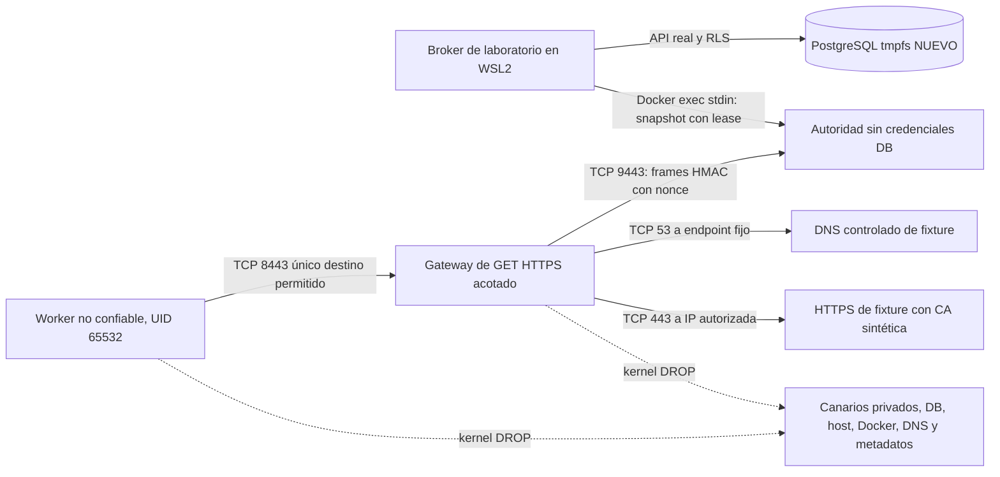

# Fase 2C — gateway obligatorio y egreso de laboratorio

**IMPLEMENTADO CON LIMITACIONES. Egreso público BLOQUEADO.** La misión autoriza
componentes y pruebas controladas, sin verificador remoto, ZAP, escaneos ni
actualización personal. La arquitectura siguiente es una **PROPUESTA** técnica;
no registra ratificación conjunta ni cambia D-001/D-002.

## Decisión y alternativas

Se eligió un gateway pequeño de GET HTTPS acotado, separado del proceso no
confiable. Tres redes dual-stack internas propias y filtros del kernel obligan
al worker a usarlo. El worker proporciona únicamente un UUID de operación. El
gateway recupera el destino y sus límites desde una autoridad independiente.
No acepta CONNECT, túneles, URL, Host, IP, puerto, cabeceras o reglas del cliente.
No es un proxy general ni una base que permita conectar ZAP sin otro diseño.

| Alternativa evaluada | Evaluación |
|---|---|
| Bridge Docker corriente | Insuficiente por sí solo: no es una política por destino ni por operación. |
| HTTP_PROXY/HTTPS_PROXY | Insuficiente: el cliente puede abrir TCP directamente si la red lo permite. |
| Gateway y filtros propios de namespace | Menor cambio verificable en esta PC; seleccionado para laboratorio. |
| Firewall global Windows/VM Docker Desktop | Requeriría otra autorización y puede afectar instalaciones ajenas; no se modifica. |
| Linux nativo o VM dedicada con gateway y firewall de perímetro | Alternativa propuesta para ensayar egreso público con controles del sistema completo. |

Las redes `--internal` restringen conectividad externa; no sustituyen los filtros
específicos ni el control de autorización. Docker documenta esas opciones en
[network create](https://docs.docker.com/reference/cli/docker/network/create/).

## Diagrama y límites de confianza



El worker pertenece solo a la red frontal; el gateway pertenece a frontal,
control y destinos. La autoridad solo pertenece a control. El fixture también
presenta canarios en frontal para probar que una red adyacente no basta para
permitir conexiones. Todos son recursos nuevos con etiqueta y nonce propios.
Ninguna red se une al proyecto personal ni publica puertos al host.

Los alias 93.184.216.10/11/12 y 2606:4700:ffff::10/11/12 corresponden exclusivamente
a servicios propios dentro de esas redes. No se contacta a sus titulares
públicos. Las representaciones de Windows, WSL2, DB, Backend, Docker y metadatos
son canarios; no se sondean los servicios reales de la PC.

## Política efectiva del kernel

Un helper efímero NET_ADMIN instala INPUT/OUTPUT/FORWARD DROP **solo dentro de
los namespaces propios**. No usa privileged, host networking ni docker.sock.
Después termina; el worker y gateway carecen de capacidades. No se editan reglas
globales de Windows, Ubuntu host, DOCKER-USER ni daemon.json.

| Namespace | Salida permitida |
|---|---|
| Worker | TCP al gateway frontal exacto en 8443, IPv4/IPv6. |
| Gateway | TCP a autoridad exacta 9443, DNS exacto 53, techo fijo de IP de fixture en 443; respuestas al worker. |
| Ambos | Solo Neighbor Solicitation/Advertisement IPv6 con hop limit 255, necesario para NDP; sin ping ni permiso ICMP genérico. |

Las respuestas establecidas se limitan por IP y puerto de origen/destino; no hay
un ACCEPT general de conexiones ESTABLISHED. DNS embebido 127.0.0.11 y localhost
no reciben excepciones. Forwarding IPv4/IPv6 se desactiva en el gateway y FORWARD
permanece DROP. El worker tiene rutas de prueba hacia el gateway para que las
negativas no dependan únicamente de ausencia de ruta. Los contadores IPv4/IPv6
se conservan y se comprueban después de las sondas.

El filtro del gateway es un **techo de destinos del laboratorio**, no una ACL
dinámica por workspace. El componente gateway confiable aplica el permiso por
operación y cancela conexiones al perderlo. El kernel no interpreta JWT, RLS,
Host, SNI, URL ni revocaciones SQL. No se afirma aislamiento frente a un gateway,
broker, daemon o kernel comprometido.

## Vinculación con autorización

El broker externo crea datos sintéticos mediante la API real de Fase 2B en
PostgreSQL tmpfs. Relee la lista de destinos y el desafío bajo JWT/RLS y comprueba
el rol actual owner/editor. El DTO legado de destino omite scope de ruta: el
broker lo vincula al endpoint anidado autenticado y lo contrasta con el scope
completo del desafío, sin cambiar el contrato existente.

Una política de laboratorio inmutable incluye UUID de operación, actor,
workspace, aplicación, destino y desafío; URL/host/esquema/puerto exactos;
conjunto numérico de IP; versiones del destino y desafío; vigencia de declaración
y desafío; límite de cinco segundos y una conexión; épocas de gateway/autoridad.
El cliente no puede proporcionar esos atributos. El alcance se vuelve a leer;
revocar el desafío, cambiar la declaración, perder membresía o caducar invalida
la publicación. Un fallo no conserva la entrada anterior como válida.

**No es una autorización de Internet:** la procedencia está fijada a laboratory,
los hosts se acotan a fixtures, el desafío permanece pendiente y la API conserva
`control_verified=false`, `execution_enabled=false`, `verify=503`. No se crea una
fila verified ni una evidencia de control real. Ningún resultado previo o fixture
se convierte en permiso operativo. Una futura implementación necesitará evidencia
operativa confiable y autorización expresa adicionales, actualmente inexistentes.

## Protocolo, caducidad y fallos

La autoridad recibe frames acotados con HMAC SHA-256 y nonce; el gateway verifica
la respuesta exacta, sus épocas y la igualdad del permiso durante la operación.
No se registran claves, JWT, token de desafío, URL ni cuerpo. HMAC autentica los
frames de este segmento de laboratorio; no proporciona confidencialidad. El
canal operativo futuro necesita su propio diseño y revisión.

El broker renueva un lease de **1.5 s contado desde el comienzo de la lectura**,
con sondeo cada 0.15 s. Una lectura/publicación lenta no extiende un snapshot
obsoleto. El gateway consulta la autoridad cada 0.1 s con timeout 0.35 s y mantiene
un deadline monotónico local, máximo cinco segundos por intercambio. Son límites
de la propuesta ensayada, no garantías de planificación en tiempo real de WSL2.

Antes de conectar se resuelve dos veces mediante DNS controlado, se comparan
cadena/conjunto con el permiso y se reautoriza. Se reutiliza PinnedHTTPS de Fase
2A sin reescribirlo: IP numérica, Host/SNI y certificado originales, TLS >=1.2,
sin DNS del sistema al conectar, proxies, credenciales, redirects o reintentos.
Se reautoriza también antes de liberar un resultado ya recibido.

Revocar impide nuevas adquisiciones después de observar la invalidación y
**cancela también el socket TLS activo del gateway**. No es revocación instantánea
en kernel: existe una ventana acotada por lectura/lease/sondeo/timeout y la
planificación del sistema. Los bytes ya enviados no se pueden retirar. Los
tiempos observados y cierre visto por el fixture se registran en resultados.
No se ofrece keep-alive ni un túnel reutilizable al worker.

Caída del broker: vence el lease y se cancelan trabajos. Caída de autoridad: no
hay autorización offline o caché permisiva. Reinicio de autoridad/gateway: una
época nueva invalida permisos anteriores, incluso no consumidos. No se restauran
automáticamente autorizaciones. Tras reiniciar el gateway solo arranca sleep;
el controlador reinstala/audita filtros antes de iniciar el servicio. Esa
secuencia confiable no es un supervisor operativo tolerante a fallos.

## Recursos y amenazas residuales

Worker/gateway/autoridad usan UID 65532, capacidades cero, no-new-privileges,
raíz read-only, tmpfs 8 MiB noexec/nosuid/nodev, CPU 0.5, memoria/swap 128 MiB,
PIDs 32 y FD 64. El fixture confiable usa UID 0 sin capacidades para leer su clave
TLS sintética. Ninguno recibe credenciales personales ni mounts del usuario.
El gateway admite máximo cuatro operaciones activas y limita frames/tiempos;
sus decisiones se acotan a 1 MiB y logs Docker rotan. El broker conserva las
credenciales del PostgreSQL propio fuera de esos contenedores.

Atacante contemplado: código del worker que ignora Python, proxy y parámetros
esperados; intenta TCP/UDP, DNS alternativo, direcciones internas, replay,
concurrencia y tráfico después de revocación. No se certifica resistencia a
escape de contenedor, administrador Docker, kernel comprometido, DoS completo,
canales laterales, otros dispositivos o adversarios con NET_ADMIN/host root.
El gateway y autoridad forman parte de la base de confianza. La CA sintética
solo sirve para pruebas; no se aceptan certificados inválidos en el transporte.

## Windows/WSL2 y alternativa de despliegue

La prueba se ejecuta en Docker Desktop 4.99.0.245822, Engine/CLI 29.9.3 y kernel
WSL2 6.18.58.1-microsoft-standard-WSL2. El proceso y namespace difieren del bridge
del Engine, de la VM y del firewall Windows. No se midió tráfico de egreso público
en ninguno de esos últimos límites. Docker documenta que Desktop media la salida
por su backend y cómo cambia su visibilidad desde Windows en
[Networking on Docker Desktop](https://docs.docker.com/desktop/features/networking/).

No se inspeccionaron ni alteraron reglas globales. Las reglas automáticas de las
redes nuevas las administra Docker; no se editaron sus cadenas globales. La
[documentación de filtrado del Engine](https://docs.docker.com/engine/network/packet-filtering-firewalls/)
explica que sus reglas de bridge/NAT y un firewall del host son capas distintas.

Para ensayar salida pública se propone una VM Linux dedicada o Linux nativo
aislado de datos personales: interfaz interna solo worker-gateway, DNS fijo
autorizado y una interfaz de egreso con filtrado por destino/puerto independiente.
Un controlador externo confiable cargaría permisos cortos y reglas por job,
incluyendo retirada de conexiones/conntrack y denegación ante reinicio. El worker
no recibiría DB, host, Docker API ni una ruta alternativa. Habría que repetir todas
las sondas con destinos controlados que atraviesen realmente ese perímetro y
probar la supervisión, cambios de ruta, DNS y recuperación. **Diseñado, no probado.**
No se supone que Linux por sí solo resuelva el filtrado o el riesgo del administrador.

El laboratorio asigna sus operaciones a un único worker del gateway; no demuestra
un proxy compartido entre tenants no confiables. El UUID de operación actúa como
capacidad de laboratorio entregada por el controlador, no como permiso que React
pueda emitir. Un despliegue futuro necesita vinculación autenticada a worker/job y
aislamiento entre jobs/workspaces, además de los UUID y versiones existentes.

## Reproducción y continuación

```bash
export DATABASE_V2_PATH=/home/mz/VulnTrack-security-phase2b/vuln-track-database
cd /home/mz/VulnTrack-security-phase2c/vuln-track-backend
.venv/bin/python -m scripts.test_v2_egress_lab
```

Requiere los locks existentes y Docker Linux; no agrega dependencias nuevas.
La imagen base tiene digest y los pins IDNA/dnspython se conservan. Los paquetes
apt no usan un snapshot binario. El contexto de construcción contiene una lista
explícita de diez archivos, sin .local, Git, bases o secretos. Se verifica colisión
de subredes y solo se eliminan contenedores/redes con la etiqueta aleatoria propia;
no se borran volúmenes personales. Una ejecución nueva invalida el JSON de éxito
anterior. Evidencias privadas ignoradas: `api-tests/v2/.artifacts/phase2c/`.
Las descargas de imágenes/paquetes son preparación confiable, fuera del plano de
datos ensayado; no se cuentan como una demostración de egreso público selectivo.
Las variables proxy heredadas se vacían para los contenedores propios, sin
cambiar la configuración global del usuario.

Véanse [resultados](V2_PHASE2C_LAB_RESULTS.md) y
[checklist](V2_ZAP_READINESS_CHECKLIST.md). Antes de verificación remota hacen falta
egreso público demostrado, permisos operativos confiables y revisión de la
plataforma. Antes de ZAP hacen falta además una decisión explícita posterior,
runner seguro, límites de tráfico, cancelación, scheduler, retención y revisión.
**Esta misión no habilita ni autoriza automáticamente ninguna de esas capacidades.**
